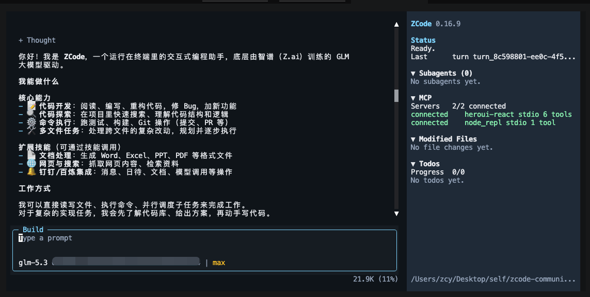

# zcode-community-cli

[](https://www.npmjs.com/package/zcode-community-cli)
[](https://www.npmjs.com/package/zcode-community-cli)
[](https://www.npmjs.com/package/zcode-community-cli)
[](https://github.com/meteorhq/zcode-community-cli/actions/workflows/ci.yml)
[](LICENSE)
[](https://github.com/zai-org/ZCode)

**中文** — 这是 [zai-org/ZCode](https://github.com/zai-org/ZCode) 官方开源 CLI 的社区 npm 打包。上游开源了完整的 CLI 源码（agent 运行时 + 终端 TUI），但一直没有发布 npm 包；本仓库用**上游自己的构建脚本**从源码构建，发布为单一 npm 包——安装后即可使用全局 `zcode` 命令。一行不改上游运行时代码，每次构建的源码 commit 都记录在包内 `dist/BUILD_INFO.json`，可完整溯源。非官方包，与 Z.AI 无隶属关系。

**English** — Community npm packaging of the official open-source [ZCode CLI](https://github.com/zai-org/ZCode). Upstream open-sources the full CLI (agent runtime + terminal TUI) but publishes no npm package; this repo builds it from source **using upstream's own toolchain** and ships it as a single npm package providing the global `zcode` command. Zero runtime-code changes — every tarball records the exact source commit it was built from (`dist/BUILD_INFO.json`). Unofficial and not affiliated with Z.AI.



## Install · 安装

```bash
npm install -g zcode-community-cli
zcode   # 在任意项目目录启动，支持 glm 系列模型登录使用
```

Requirements · 环境要求：

- **Node.js >= 22.18**（运行时依赖 Node 原生 TS type-stripping；推荐 Node 24 LTS）
- 原生模块 `koffi` 对主流平台自带预编译产物；个别精简版 Linux 可能需要编译工具链

## Usage

```bash
zcode            # open the full-screen TUI in the current directory
zcode doctor     # inspect runtime and packaging assumptions
zcode --version
```

Other built-in commands follow upstream (`app-server`, `login [zai|bigmodel]`, `logout`, `commands list`, …). Run `zcode --help` or see the upstream repo for details.

## How this package is built

The upstream repository open-sources the CLI but does not publish it to npm. This repo closes that gap **without forking runtime code**:

1. The ZCode source is resolved in this order: `--source <path>` / `ZCODE_SOURCE` env, a local checkout next to this repo, or — fully self-contained — a shallow `git clone` of the ref pinned in [`upstream.json`](upstream.json) (a tag, e.g. `v3.14.3`) into `.upstream/`, with dependencies installed automatically. This is exactly what CI does.
2. The CLI is built inside that source repo using upstream's own commands (`turbo run build` + `scripts/build.mjs --desktop-agent`, i.e. the same minified bundle the desktop app ships).
3. The bundle (`dist/zcode.cjs`) keeps `@zcode/tui`, `playwright-core` and `koffi` external by design. The `@zcode/*` workspace packages that are resolved at runtime (`tui`, `shared`, `contracts`, `i18n`, `model-option-map`) are vendored under `dist/node_modules/@zcode/`, mirroring the source workspace layout; the rest are regular pinned npm dependencies of this package.
4. `dist/BUILD_INFO.json` records the exact source commit and upstream version each tarball was built from.

Useful build flags: `--upstream` (force the clone path), `--refresh` (drop `.upstream/` and re-clone), `--upstream-ref <tag>` (one-off override of the pinned ref), `--no-build` (re-stage from an already-built source tree).

## Rebuilding locally

```bash
npm install                      # installs this package's runtime deps
npm run build                    # auto-clones upstream per upstream.json if no local source
npm run verify                   # smoke tests + tarball completeness + version policy check
```

If you keep a checkout of the upstream repo around (e.g. `~/Projects/ZCode`), the build reuses it automatically; pass `--source <path>` to be explicit.

## Automated releases (GitHub Actions)

- **CI** (`.github/workflows/ci.yml`): on every push/PR — build from the pinned upstream ref and run the full verification. No publish.
- **Auto-release** (`.github/workflows/auto-release.yml`): runs daily on a schedule (also manually triggerable). Checks upstream for new release tags; when one appears it syncs versions, commits the bump, builds, verifies and publishes — completely hands-off. Publish versions follow the policy automatically (mirror the upstream version, or `-N` suffix if it is already on npm), and each publish is tagged as a GitHub release.
- **Release** (`.github/workflows/release.yml`): manual `workflow_dispatch` — build, verify, then `npm publish --provenance --access public`. Toggle the `dry-run` input to rehearse without publishing.

Setup once in the GitHub repo settings:

1. Add an `NPM_TOKEN` secret (an npm access token with publish rights for `zcode-community-cli`).
2. Tracking a new upstream release manually (if you don't want to wait for the daily check):

   ```bash
   npm run sync-version -- v3.15.0   # the new upstream tag
   git add -A && git commit -m "Track upstream v3.15.0" && git push
   ```

   The sync script fetches the upstream CLI version at that tag, updates `upstream.json` and `package.json` (appending `-N` automatically if the version is already on npm), and CI on the push validates the new build.

Caveat: GitHub disables scheduled workflows after 60 days without repository activity — a quiet upstream can silently pause the daily check. If that happens, re-enable the workflow (or push any commit).

`npm run verify` enforces the version policy: the package version must equal the upstream `apps/zcode-cli` version, or be `<upstream>-N` for packaging-only republishes.

## Versioning

Versions mirror `apps/zcode-cli/package.json` in the upstream repo. If a packaging-only fix is needed for the same upstream version, a prerelease suffix is used (`0.16.9-1`).

## License

- Upstream ZCode source: **Apache-2.0** (see `LICENSE`, full text from the upstream repository).
- Bundled third-party components keep their original licenses; the consolidated notice file is shipped inside the package (`dist/THIRD-PARTY-NOTICES.md`).
- Packaging scripts in this repository: Apache-2.0.
